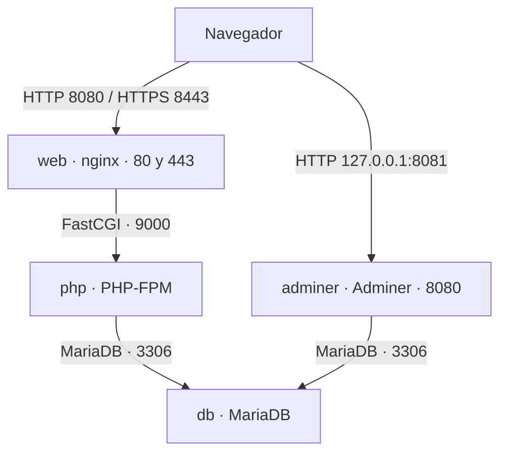

# NovaHarvest

Proyecto de Implantación de Aplicaciones Web de Jaime Pico. NovaHarvest permite consultar los excedentes de productores del Valle del Jerte y registrar solicitudes de aviso.

## Arranque

Se necesita Docker con Docker Compose, Git y OpenSSL. Ejecuta los comandos desde la terminal del equipo donde vas a arrancar el proyecto.

### 1. Descargar el repositorio

```bash
git clone https://github.com/vjp-jaimePG/NovaHarvest.git novaharvest-iaplw
cd novaharvest-iaplw
```

### 2. Preparar las variables de entorno

```bash
cp .env.example .env
```

Abre `.env`. Mantén `DB_NAME=novaharvest` y `DB_USER=novaharvest_app`. Rellena `DB_PASS` y `DB_ROOT_PASSWORD` con dos contraseñas distintas. La primera la usa la aplicación y la segunda se utiliza para administrar MariaDB.

### 3. Generar el certificado HTTPS

```bash
mkdir -p nginx/certs
openssl req -x509 -nodes -days 365 -newkey rsa:2048 \
  -keyout nginx/certs/novaharvest.key \
  -out nginx/certs/novaharvest.crt \
  -subj "/CN=localhost"
```

El certificado es autofirmado. El navegador puede mostrar un aviso al abrir la web por primera vez.

### 4. Arrancar los contenedores

```bash
docker compose config -q
docker compose up -d --build
docker compose ps
docker compose exec web nginx -t
```

Comprueba que aparecen los servicios `web`, `php`, `db` y `adminer`. MariaDB debe aparecer como `healthy`.

### 5. Cargar las tablas y los datos

Este paso se hace una vez por cada volumen nuevo de MariaDB.

```bash
docker compose cp db/novaharvest.sql db:/tmp/novaharvest.sql
docker compose exec db mariadb --default-character-set=utf8mb4 -u root -p
```

Introduce la contraseña de `DB_ROOT_PASSWORD`. En el prompt de MariaDB, ejecuta:

```sql
SOURCE /tmp/novaharvest.sql;
USE novaharvest;
SHOW TABLES;
EXIT;
```

Deben aparecer las tablas `avisos` y `excedentes`.

### 6. Comprobar las páginas

| Dirección | Qué se comprueba |
|---|---|
| <http://localhost:8080/> | Redirige a HTTPS en el puerto 8443. |
| <https://localhost:8443/> | Portada de NovaHarvest. |
| <https://localhost:8443/excedentes.php> | Muestra los cuatro productos con kilos disponibles. |
| <https://localhost:8443/avisos.html> | Formulario de aviso. Al enviarlo, `avisos.php` confirma el registro. |
| <https://localhost:8443/temporada.md> | Calendario servido como texto en UTF-8. |
| <https://localhost:8443/estado.php> | Fecha, hora, identificador de PHP y versión de MariaDB. |
| <http://localhost:8081/> | Adminer, accesible desde el propio equipo. |

En Adminer selecciona el sistema MySQL, indica el servidor `db`, el usuario `novaharvest_app`, la contraseña de `DB_PASS` y la base de datos `novaharvest`. Puedes comprobar el envío del formulario en la tabla `avisos`.

### Parar y volver a arrancar

```bash
docker compose down
docker compose up -d
```

`docker compose down` elimina los contenedores y conserva los datos del volumen `dbdata`.

Para empezar de cero y **borrar los datos de MariaDB**, ejecuta:

```bash
docker compose down -v
docker compose up -d --build
```

Después, vuelve a cargar `db/novaharvest.sql` siguiendo el paso 5.

## Arquitectura



El navegador que pide `http://localhost:8080/excedentes.php` recibe una redirección 301 a HTTPS. En la segunda petición, nginx envía el script a `php:9000`. PHP-FPM ejecuta el código y consulta los excedentes en `db:3306` mediante PDO. PHP genera la tabla HTML y nginx devuelve el resultado al navegador.

`web` y `php` montan `./web` en `/usr/share/nginx/html`. Así PHP-FPM encuentra el archivo en la ruta que le pasa nginx. `db` utiliza el volumen `dbdata` en `/var/lib/mysql` para conservar los datos.

## Configuración

| Archivo o carpeta | Servicio | Destino o uso | Función |
|---|---|---|---|
| `compose.yaml` | Docker Compose | Se lee en el equipo anfitrión | Define servicios, puertos, dependencias y volúmenes. |
| `.env.example` | Docker Compose | Plantilla para crear `.env` en la raíz | Indica las variables que se deben completar para MariaDB y PHP. |
| `nginx/default.conf` | `web` | `/etc/nginx/conf.d/default.conf` | Configura HTTP, HTTPS, los archivos estáticos y FastCGI. |
| `nginx/certs/` | `web` | `/etc/nginx/certs` | Contiene el certificado y la clave que se generan en cada equipo. |
| `php/Dockerfile` | `php` | Contexto de construcción `./php` | Parte de `php:8.3-fpm-alpine` e instala `pdo_mysql` y `mysqli`. |
| `php/www.conf` | `php` | `/usr/local/etc/php-fpm.d/www.conf` | Configura el puerto 9000 y los procesos de PHP-FPM. |
| `php/php.ini` | `php` | `/usr/local/etc/php/conf.d/novaharvest.ini` | Configura la memoria, los errores y la zona horaria. |
| `db/novaharvest.sql` | `db` | Se copia a `/tmp/novaharvest.sql` para importarlo | Crea las tablas, inserta los productos iniciales y asigna los permisos. |
| `.gitignore` | Git | Se lee en el equipo anfitrión | Excluye `.env` y los certificados del repositorio. |

## Base de datos

La base `novaharvest` tiene dos tablas:

- `excedentes`: contiene el producto, el productor, el pueblo, los kilos y el precio por kilo. El SQL carga cinco productos y la web muestra los cuatro que tienen más de cero kilos.
- `avisos`: guarda el nombre, el correo, el producto solicitado y la fecha del aviso. MariaDB asigna la fecha al insertar el registro.

La aplicación utiliza `novaharvest_app`. Tiene `SELECT` para consultar datos e `INSERT` para registrar avisos sobre `novaharvest.*`. La contraseña de `root` se utiliza para tareas de administración.

Para comprobar los permisos:

```bash
docker compose exec db mariadb -u root -p
```

```sql
SHOW GRANTS FOR 'novaharvest_app'@'%';
EXIT;
```

La salida debe incluir `USAGE` y `SELECT, INSERT` sobre `novaharvest.*`.